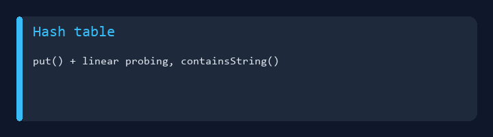

# COSC 111 - Programming and Data Structures



College coursework portfolio for **COSC 111** at Eastern Michigan University.  
Eclipse Java labs: **hash tables**, **binary I/O**, **inheritance**, and **polymorphism**, plus a JavaFX checkerboard exercise.

**Author:** [Julio Barros](https://github.com/Jkbarros)  
**Index:** [college-projects](https://github.com/Jkbarros/college-projects)

## What is in this repository

| Area | Description |
|------|-------------|
| [Labs catalog](docs/labs-catalog.md) | Map each lab to markdown notes and project paths |
| [Hash table lab](docs/lab-hash-table.md) | Open addressing, `put` / `containsString` |
| [Binary I/O lab](docs/lab-binary-io.md) | `numbers.dat` averages, `Person` serialization |
| [Inheritance lab](docs/lab-inheritance.md) | `Vehicle` / `Truck` and `Payment` / `CashPayment` |
| [Polymorphism lab](docs/lab-polymorphism.md) | Movie late fees, `Dice` extends `Random` |
| [JavaFX checkerboard](docs/project-javafx-checkerboard.md) | Exercise 14.6 from `Project Java.txt` |
| [Repository guide](docs/repository-guide.md) | Import Eclipse projects |

### Highlights

- Runnable `.java` sources in four lab trees under the repo root
- [`Output.png`](Output.png) — sample polymorphism run (also in [lab doc](docs/lab-polymorphism.md))
- Markdown walkthroughs with code excerpts for GitHub readers

## Topics covered


## Run the labs

1. Install [Eclipse IDE for Java](https://www.eclipse.org/) (or BlueJ).
2. **File → Import → Existing Projects into Workspace** for each path in the [labs catalog](docs/labs-catalog.md).
3. Set the run configuration **working directory** to the project folder when labs need `.dat` files.
4. Run the `main` class noted in each lab doc (`Problem1`, `Problem2`, `Main`, `Dice`, etc.).

**Regenerate README GIF:**

```bash
pip install -r requirements.txt
python scripts/generate_readme_demo.py
```

## Related repos

| Course | Link |
|--------|------|
| COSC 314 - Discrete Structures | [computational-discrete-structures](https://github.com/Jkbarros/computational-discrete-structures) |
| CET 151 - Computing in Engineering Tech | [cet-151-intro-computing-engineering-tech](https://github.com/Jkbarros/cet-151-intro-computing-engineering-tech) |
| college-projects index | [college-projects](https://github.com/Jkbarros/college-projects) |

## Notes for readers

- This repo documents **my submitted work** for academic context only.
- Committed `.class` files under `bin/` are from the original Eclipse export; prefer compiling from `.java` locally.

## License

Content © Julio Barros. Use at your own risk.
