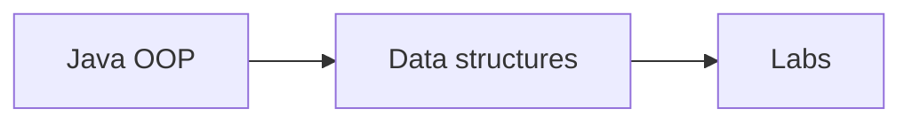

# COSC 111 - Programming and Data Structures

College coursework archive for **COSC 111 - Programming and Data Structures** at Eastern Michigan University.  
Eclipse/BlueJ-style Java labs: hash tables, binary structures, inheritance, and polymorphism.

**Author:** [Julio Barros](https://github.com/Jkbarros)  
**Index:** [college-projects](https://github.com/Jkbarros/college-projects)

## What is in this repository

| Area | Description |
|------|-------------|
| [Repository guide](docs/repository-guide.md) | How to open each lab project |
| [`Lab/`](Lab/) | Hash table implementation (`HashTable.java`) |
| [`lab_binary/`](lab_binary/) | Binary search tree exercises |
| [`lab_inheritance/`](lab_inheritance/) | Vehicle / person inheritance lab |
| [`lab_polymorphism/`](lab_polymorphism/) | Movie rental polymorphism lab |

### Highlights

- Hash table lab (`Lab/Lab/src/HashTable.java`)
- Binary, inheritance, and polymorphism Eclipse projects
- `Output.png` / `Project Java.txt` notes from coursework

## Topics covered

## Run the labs

1. Install [Eclipse](https://www.eclipse.org/) or [BlueJ](https://bluej.org/).
2. Import each folder that contains `.project` (for example `Lab/Lab`, `lab_binary/lab_binary`).
3. Open the `src` package and run the `main` class for that assignment.

## Related repos

| Course | Link |
|--------|------|
| COSC 314 - Discrete Structures | [computational-discrete-structures](https://github.com/Jkbarros/computational-discrete-structures) |
| college-projects index | [college-projects](https://github.com/Jkbarros/college-projects) |

## Roadmap

- [ ] Convert lab write-ups to markdown in `docs/`
- [ ] Strip Eclipse `.class` artifacts from history if repos grow large

## Notes for readers

- This repo documents **my submitted work** for academic context only.
- EMU or publisher course materials are not redistributed beyond my own submissions.

## License

Content © Julio Barros. Use at your own risk.
