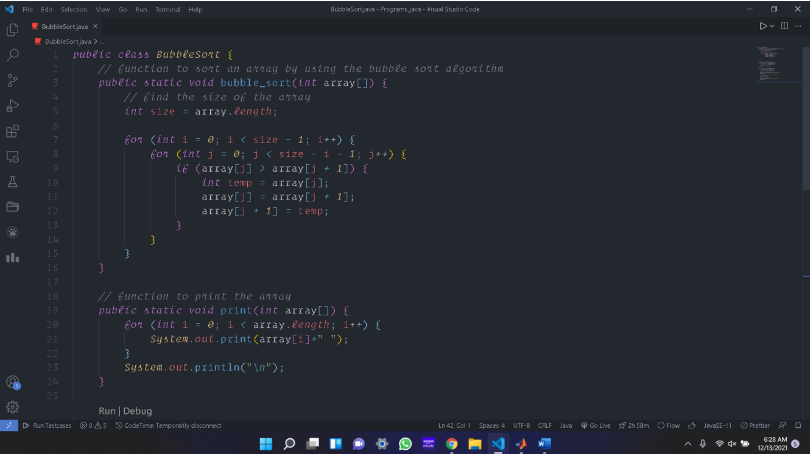

# Lab — Polymorphism (movie rental)

**Sources:** [`Main.java`](../lab_polymorphism/lab_polymorphism%20copy/src/Problem1/Main.java), [`Movie.java`](../lab_polymorphism/lab_polymorphism%20copy/src/Problem1/Movie.java), genre classes (`Action`, `Comedy`, `Drama`)  
**Course:** COSC 111 (EMU) · **Author:** Julio Barros

## Base class `Movie`

- Fields: `id`, `movieTitle`, `yearRelease`, default `lateFee = 2`.
- **`equalsTo(Movie m)`** — equality by `id` only.
- **`calcLateFee(int days)`** — `days * lateFee` (overridden in subclasses).

## Overridden late fees

| Class | Late fee multiplier |
|-------|---------------------|
| `Movie` | 2 per day |
| `Action` | 3 per day |
| `Comedy` | 2 per day (`(int)2.5`) |

```java
Action c = new Action(3, "tite3", 2021);
System.out.print(c.calcLateFee(5));
```

## `Dice` — extending `Random`

[`Dice.java`](../lab_polymorphism/lab_polymorphism%20copy/src/Problem1/Dice.java) overrides `nextInt(int)` to bias rolls and prints 100 sample dice faces from `main`.

## Run

Import `lab_polymorphism/lab_polymorphism copy`, run **`Problem1.Main`** or **`Dice.main`**.


